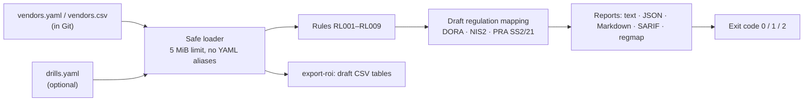

<div align="center">


[](https://github.com/chriswayneh/resilint/releases/latest) [](LICENSE) [](https://github.com/chriswayneh/resilint/actions/workflows/ci.yml)

**Vendor resilience checks that run every time your vendor list changes.**

[Docs](docs/usage.md) · [Security](SECURITY.md) · [Roadmap](ROADMAP.md) · [Releases](https://github.com/chriswayneh/resilint/releases)

</div>

An open-source command-line tool and GitHub Action that reads your critical-vendor register from a YAML or CSV file in Git and flags missing or inconsistent resilience commitments, mapped to DORA, NIS2, and the UK PRA's SS2/21.

**Status:** [v1.0.0-rc1](https://github.com/chriswayneh/resilint/releases/tag/v1.0.0-rc1) is published for validation on [TestPyPI](https://test.pypi.org/project/resilint/1.0.0rc1/). See [Releases](https://github.com/chriswayneh/resilint/releases) for published builds. The latest stable release remains [v0.4.0 released](https://github.com/chriswayneh/resilint/releases/tag/v0.4.0) (2026-10-24), adding drill records and failed-drill findings. It includes SARIF, regulation mapping reports, and draft register-of-information export. v1 is in development and is not released; resilint is not published on PyPI. Features marked **development-only** are on `main` and are not in v0.4.0. See the [roadmap](ROADMAP.md).

> **A note on this repo:** This GitHub account is my personal playground, where I experiment, learn, and build security tools in the open. Projects here are personal work, not a product or company offering.

## Demo

**The decision it supports:** which critical vendors to escalate, re-contract, or re-test before an auditor or regulator asks.

Run it against the fictional register below:

```bash
pip install git+https://github.com/chriswayneh/resilint.git@v0.4.0
resilint check vendors.yaml                  # gap list
resilint check vendors.yaml --format regmap  # gaps grouped by regulation
```

<details>
<summary>Fictional register and captured v0.4.0 output</summary>

A one-vendor register (`vendors.yaml`):

```yaml
processes:
  - {id: payments, criticality: critical, rto_hours: 4}
vendors:
  - id: example-payments-cloud
    criticality: critical
    notification_sla_hours: 24
    recovery_time_hours: 8
    contacts: [{email: incidents@example.com}]
    exit_plan: false
    last_tested: 2025-03-01
    contacts_verified: 2026-09-01
    supports_processes: [payments]
```

Real output (generated by resilint 0.4.0 on 2026-10-24):

```text
HIGH     RL004 example-payments-cloud: no documented exit plan
         maps to: DORA Art. 28(8), Art. 30(3)(f); NIS2 Art. 21(2)(d); PRA SS2/21 ch. 10 (draft mapping, not legal advice)
HIGH     RL006 example-payments-cloud: recovery time 8h exceeds payments RTO 4h
         maps to: DORA Art. 30(2)(e), 30(3)(a); NIS2 Art. 21(2)(c); PRA SS2/21 ch. 10 (draft mapping, not legal advice)
MEDIUM   RL005 example-payments-cloud: last resilience test 2025-03-01 is older than 365 days
         maps to: DORA Art. 30(3)(c)-(d); NIS2 Art. 21(2)(f); PRA SS2/21 ch. 10 (draft mapping, not legal advice)
3 findings (2 high, 1 medium).
```

`--format regmap` (NIS2 excerpt; DORA and PRA SS2/21 tables follow the same shape):

```markdown
## NIS2

| Reference | Rules | Findings | Vendors |
|---|---|---|---|
| Art. 21(2)(d) | RL001, RL003, RL004, RL007, RL008 | 1 | example-payments-cloud |
| Art. 21(2)(c) | RL002, RL006, RL009 | 1 | example-payments-cloud |
| Art. 21(2)(f) | RL005, RL009 | 1 | example-payments-cloud |
```

The check exits `1` because findings reached the default `high` threshold (re-verified against the v0.4.0 tag on 2026-11-03). The register is entirely fictional. **Draft, not legal advice.** All references are a draft mapping.

</details>

## Features

- [x] **Missing commitments** for any vendor marked critical or high: no incident notification SLA, no recovery time commitment, no email or phone contact, no documented exit plan, or no resilience test within the required window.
- [x] **Consistency problems:** a vendor recovery time slower than a dependent process's RTO, too many critical processes concentrated on one vendor (threshold you set), contacts never verified or not verified within a window (default 180 days), and a failed latest drill.

- [x] **Released in v0.4.0:** YAML/CSV registers, nine rules (RL001–RL009), text/JSON/Markdown/SARIF/regmap output, draft RoI export, drill records and the `chriswayneh/resilint@v0.4.0` GitHub Action.
- [x] **Development-only (on `main`, not in v0.4.0):** `resilint init`, `resilint explain`, the pre-commit hook, Action outputs, `.resilint.yaml` rule configuration and baselines. See the [reference](docs/reference.md) and [changelog](CHANGELOG.md).

<details>
<summary>Business context and the evidence it produces</summary>

### The problem, in business terms

- **A signed contract is the starting point, not proof of resilience.** Notification windows, recovery times, and exit plans are only useful if they exist, are current, and match what the business actually needs.
- **Annual questionnaires go stale.** A vendor's answers are a snapshot. Contacts change, services move, and new business processes start depending on a supplier between review cycles.
- **One vendor outage can cascade.** When several critical processes rely on the same supplier, a single failure becomes a business-wide incident. That concentration is often invisible until it happens.

Regulators now expect firms to show this is managed continuously, not once a year.

### Evidence it produces

| Audience | What they get |
|---|---|
| Board and risk committee | A short Markdown summary: how many critical vendors, how many have gaps, and where concentration risk sits |
| Internal and external auditors | Timestamped JSON findings tied to a Git commit, so every result is reproducible from history |
| Regulators | Each finding tagged with a draft article mapping, plus draft CSV export toward the DORA register-of-information templates; completion and validation are still required |
| Engineering and procurement | Pull request annotations (SARIF) showing exactly which entry needs fixing |

</details>

Exit codes make it CI-friendly: `0` clean, `1` findings at or above your chosen severity, `2` bad input.

## Architecture



Everything above runs locally and offline. Nothing is sent anywhere unless your own CI workflow uploads a SARIF report (see [Limits](#limits)).

## Quick start

```bash
git clone --branch v0.4.0 --depth 1 https://github.com/chriswayneh/resilint.git
cd resilint
pip install .
resilint check examples/vendors.yaml               # text
resilint check examples/vendors.csv --format md    # one-page gap report for leadership
resilint check examples/vendors.yaml --format json --fail-on medium --stale-days 180
```

The [CLI guide](docs/usage.md) lists every option, defaults and output-path protections. Exit codes are `0` for a passing check, `1` for threshold findings and `2` for input/output errors.

After stable v1 publication, install with `python -m pip install "resilint==1.0.0"` or `pipx install resilint`. See the [installation guide](docs/install.md) for version pinning, isolated environments and the current Git-release alternative.

<details>
<summary>Example Markdown gap report</summary>

Example Markdown report (from the fictional `examples/` data):

```markdown
# Vendor resilience gap report

- Vendors in register: **2**
- Critical/high vendors checked: **2**
- Vendors with gaps: **1**
- Findings: **2** high, **2** medium

| Severity | Vendor | Gap | Rule | Maps to |
|---|---|---|---|---|
| high | example-cloud-wms | no documented exit plan | RL004 | DORA Art. 28(8), Art. 30(3)(f); ... |
| high | example-cloud-wms | recovery time 8h exceeds order-fulfilment RTO 4h | RL006 | DORA Art. 30(2)(e), 30(3)(a); ... |
| medium | example-cloud-wms | last resilience test 2024-11-12 is older than 365 days | RL005 | ... |
| medium | example-cloud-wms | contacts last verified 2025-01-15, older than 180 days | RL008 | ... |
```

</details>

## CLI at a glance

| Command | What it does | Availability |
| --- | --- | --- |
| `resilint check FILE` | Run rules; `--format text\|json\|md\|sarif\|regmap`, `--fail-on`, `--stale-days`, `--contact-days`, `--max-critical` | v0.4.0 |
| `resilint check FILE --drills LOG` | Apply recorded drill outcomes (RL009) | v0.4.0 |
| `resilint export-roi FILE --out-dir DIR` | Draft register-of-information CSV tables | v0.4.0 |
| `resilint drill record FILE --vendor ID ...` | Append tabletop/test evidence to a drill log | v0.4.0 |
| `resilint check --baseline / --write-baseline` | Report only new findings | development-only |
| `resilint init [PATH]` | Write a fictional starter register | development-only |
| `resilint explain RLxxx` | Describe a rule and its draft references | development-only |

Full flags: [CLI guide](docs/usage.md). Exit codes: `0` clean, `1` findings at or above threshold, `2` input/output error.

## Limits

- **Draft mapping, not legal advice.** Regulation references are draft guidance and not a compliance guarantee. Confirm interpretations with your compliance and legal teams. The RoI export is partial and requires completion and validation before submission.
- **Local and offline.** Checks run on your own data and leave the register unchanged. resilint does not contact vendors, scrape websites, use SaaS or send telemetry. Report/export commands write local files; `drill record` writes a local drill log.
- **Optional CI upload is yours.** If you use the [SARIF workflow](docs/reference.md#github-action), GitHub Code Scanning receives vendor identifiers, finding messages and source locations. Use it only for registers suitable for your repository's access policy.
- **Use fictional data to try it.** Never commit real vendor records, PHI, PII or credentials to a public repository. See [SECURITY.md](SECURITY.md).
- **It checks commitments, not vendors.** It complements TPRM and GRC platforms; it does not replace due diligence.

<details>
<summary>How it fits into a GRC program</summary>

### How it fits into a GRC program

resilint **complements, and does not replace,** third-party risk management (TPRM) and GRC platforms.

- **TPRM platforms** run questionnaires, due diligence, and vendor scoring. resilint checks that the commitments you already hold are recorded, current, and consistent.
- **Tabletop exercise tools** run scenarios but do not model contract commitments. resilint records whether a test happened and, with `drill record`, attaches each tabletop or test result to the vendor.
- **DORA register-of-information validators** check that a file has the right format. resilint checks whether the underlying commitments actually exist and make sense together.

Because the register lives in Git, every change has an author, a review, and a history auditors can follow.

</details>

## Documentation

- [Installation](docs/install.md): Python/platform support, version pinning and isolated environments.
- [CLI usage](docs/usage.md), [reference](docs/reference.md) and [rules](docs/rules.md).
- [Register schema](docs/schema.md), [configuration](docs/config.md) and [baselines](docs/baseline.md).
- [CI integration](docs/ci.md), [drills](docs/drills.md) and [draft RoI export](docs/roi.md).
- [FAQ](docs/faq.md) and [v1 stability policy](docs/stability.md).
- [Changelog](CHANGELOG.md), [roadmap](ROADMAP.md) and [security policy](SECURITY.md).

These guides include development features planned for v1; the published v0.4.0 release is identified above. The stability policy defines supported interfaces, additive changes and deprecation notice periods.

<!-- Compatibility anchors for sections moved to docs/reference.md -->
<a id="regulation-mapping-report-and-draft-roi-export"></a><a id="drill-records"></a><a id="github-action"></a><a id="starter-register"></a><a id="pre-commit"></a><a id="input-schema"></a><a id="rules"></a><a id="regulatory-mapping-draft"></a><a id="roadmap"></a><a id="security"></a><a id="development-methodology"></a>

<details>
<summary>Sections moved to the reference guide</summary>

Moved sections: [GitHub Action](docs/reference.md#github-action) · [pre-commit](docs/reference.md#pre-commit) · [Input schema](docs/reference.md#input-schema) · [Rules](docs/reference.md#rules) · [Regulatory mapping](docs/reference.md#regulatory-mapping-draft) · [Drills](docs/reference.md#drill-records) · [RoI export](docs/reference.md#regulation-mapping-report-and-draft-roi-export) · [Starter register](docs/reference.md#starter-register) · [Roadmap](docs/reference.md#roadmap)

</details>

## Contributing

See [CONTRIBUTING.md](CONTRIBUTING.md) for setup, validation gates (`ruff check .`, `mypy src`, `pytest -q`, `python scripts/check_links.py`, `git diff --check`) and the fictional-data-only rule. Report vulnerabilities privately as described in [SECURITY.md](SECURITY.md).

## How this project is built

This project uses an adapted [AWS AI-DLC](https://github.com/awslabs/aidlc-workflows) documentation workflow: inception before implementation, recorded stage decisions, comprehensive tests and security review, and one roadmap task per PR. See the [local workflow records](aidlc-docs/README.md) and [audit](aidlc-docs/audit.md). No native AWS runtime is installed by this adoption; GitHub approval, merges, tags, releases and settings remain user-controlled.

### Built with

- Python 3.10+ (standard library + PyYAML)
- AI-assisted development with Grok Bot, Cursor, Codex, and Claude

## License

[MIT](LICENSE)
